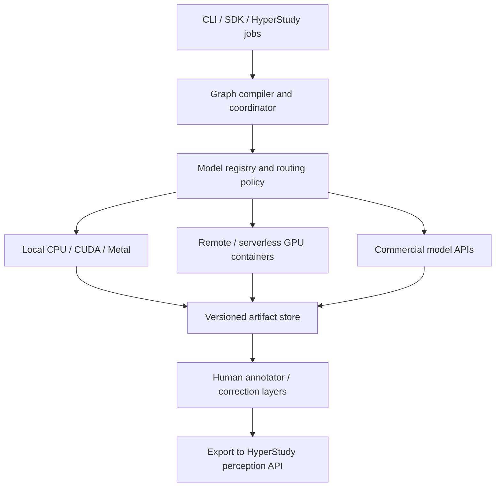
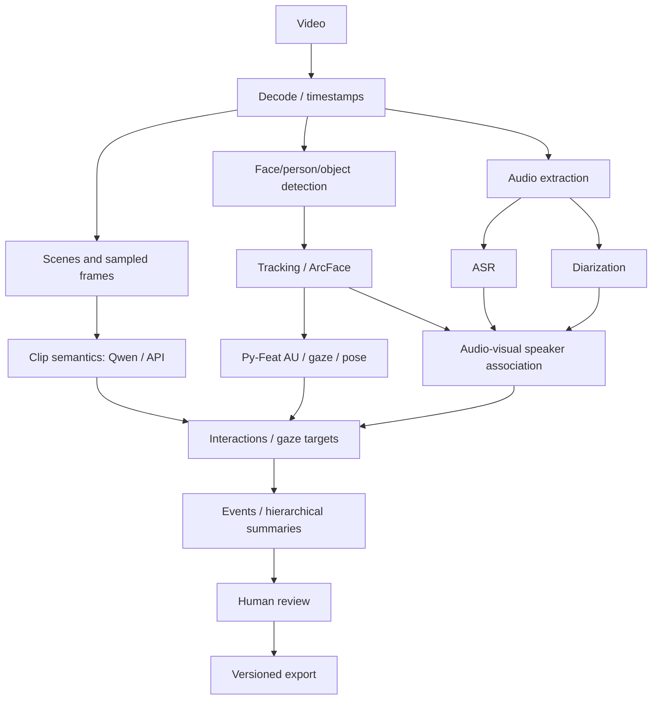

# Distributed Multimodal Perception Graph

Design spec v0.1 — October 23, 2026

## Objective

Build a standalone CLI-first, cross-platform directed acyclic graph (DAG) orchestrator for asynchronous video perception. It must run the same graph on local CPUs/GPUs, remote Docker workers, on-demand cloud GPUs, and commercial model APIs. It produces reusable, timestamped, provenance-tracked artifacts for a standalone annotator and HyperStudy's existing APIs. The orchestrator does not own the annotation database or agent API.

## Architecture



Components: (1) declarative graph schema and validator; (2) model registry with versioned manifests; (3) persistent single-coordinator scheduler; (4) pluggable execution backends; (5) local filesystem/S3-compatible content-addressed artifact storage; (6) correction and export adapters. Pass URIs between workers, not large tensors through the coordinator.

## Framework research and recommendation

| Option | Benefits | Drawbacks | Decision |
|---|---|---|---|
| Prefect 3 | Python tasks, retries, caching, background workers, concurrency limits | Extra runtime/control-plane dependencies; no automatic heterogeneous model routing | **Prototype against** |
| Dagster | Excellent asset lineage, partitioning, Docker/Kubernetes executors | Data-platform abstractions may be heavy for a standalone desktop CLI | Revisit if asset governance dominates |
| Ray Core | Distributed GPU-aware resource scheduling, actors, data locality | Cluster complexity; less natural as a universal desktop/API orchestration layer | Optional remote execution backend |
| Custom asyncio + SQLite | Lightweight, cross-platform, fully tailored routing and artifact contracts | Must implement durable states, retries, leasing, recovery, logging | **Recommended MVP**, pending Prefect comparison |

Important design choice: Keep graph IR, node manifests and backend interfaces framework-independent. Compare a small custom scheduler with a Prefect proof-of-concept before committing. Neither Prefect nor Ray eliminates the need for your model-specific routing and artifact protocols.

Research: Prefect tasks, Prefect concurrency, Dagster executors, Dagster partitions, Ray scheduling.

## Example perception graph



Each model declares its actual input requirements; the diagram is illustrative. Segment video into temporal partitions when safe; use overlapping windows and reconciliation for temporal context. Stateful tracking and diarization may require long-lived workers. Preserve original PTS/timebase and mapping to normalized integer-microsecond video timestamps, including variable-FPS media.

## Graph specification example

```yaml
schema_version: 1
pipeline: perception-v1
inputs:
  video: {type: video, uri: 'file:///data/session.mp4'}
outputs:
  store: 'file:///results/session/'
policy:
  placement: hybrid
  privacy: local-preferred
  max_cost_usd: 10
  retries: 2
nodes:
  - id: decode
    uses: core.decode@1.1.0
    inputs: {video: '$inputs.video'}
  - id: faces
    uses: vision.face-track@1.0.0
    inputs: {frames: '$nodes.decode.frames'}
    backend: auto
  - id: asr
    uses: audio.asr@1.0.0
    inputs: {audio: '$nodes.decode.audio'}
  - id: fuse
    uses: fusion.timeline@1.0.0
    inputs:
      faces: '$nodes.faces.tracks'
      transcript: '$nodes.asr.transcript'
```

## Model manifest

```yaml
id: vision.face-track
version: 1.0.0
inputs: {frames: frame_sequence.v1}
outputs: {tracks: face_tracks.v1}
runners:
  - kind: oci
    image: 'registry.example/face-track@sha256:REPLACE_DIGEST'
    platforms: [linux/amd64]
    accelerator: cuda
    minimum_vram_gb: 8
  - kind: native
    platforms: [darwin/arm64, windows/amd64, linux/amd64]
    accelerator: cpu
resources: {cpu_cores: 4, memory_gb: 8}
execution: {partitionable: true, deterministic: true}
privacy: {external_upload: false}
license: {review_required: true}
```

Container images are not assumed to work on macOS Metal or Windows natively. Model-specific native/ONNX/MPS variants need explicit validation. Detect Docker/WSL2 availability and GPU capabilities in preflight. Never silently download large model weights.

## Artifacts and caching

Canonical types: media metadata, sampled frames/crops, face/person/object tracks, AU/gaze/pose time series, ASR words, diarized speaker turns, audio-visual identity associations, embeddings, interaction events, scene descriptions, and hierarchical summaries. Prefer Parquet/Arrow for time series and tabular tracks; JSON Schema/Pydantic for manifests and events; filesystem or S3-compatible object storage for binaries. Every record carries source video ID, timestamps, confidence/uncertainty where available, producer/model version, and relevant track IDs.

Node requests contain typed input artifact URIs, config, run/partition ID, output location, and secret references. Responses contain validated output URIs, content hashes, duration, usage, provenance and error codes. Atomic output commit: write temporary outputs, validate and checksum, then publish a manifest.

Cache key = hash of input content hashes + canonical config + model/weights/container digest + schema version + partition boundaries + relevant runtime parameters. Cache observed nondeterministic API results while recording provider model ID, prompt revision, sampling settings and response metadata; do not claim bit-for-bit reproducibility. Human corrections are immutable overlay revisions; rerun only nodes whose declared inputs change.

## Scheduler and execution policy

A single coordinator stores run state in SQLite for local use, with a migration path to Postgres for multi-user cloud operations. Task states: pending, ready, leased, running, succeeded, cached, failed, canceled. Only schedule when dependencies are committed. Track CPU/RAM, GPU VRAM and device leases, provider quotas, disk and transfer budgets. Retry transient errors with backoff; treat schema/privacy/license failures as terminal. Reclaim expired leases after crashes. Support cancellation, resume, partial reruns and concurrency limits. Guarantee at-least-once execution and effectively-once artifact publication, not exactly-once remote API billing.

Backend interface: probe_capabilities(), estimate(node, inputs), stage_inputs(), submit(), poll(), cancel(), collect(), cleanup(). Initial adapters: native subprocess, local Docker/OCI, remote worker over HTTPS/SSH, serverless GPU, and OpenAI/Anthropic inference APIs. Add Ray/Kubernetes only when demand warrants. Worker contracts should not expose provider-specific details to the graph schema.

Placement: filter on platform, CPU/RAM/VRAM, accelerator, model support, credentials, privacy, licensing and network accessibility. Rank eligible backends by estimated marginal cost, startup/queue delay, runtime and transfer. Default to local CPU for cheap preprocessing, local GPU for installed specialist models, on-demand GPU for CUDA-only inference, and commercial batch APIs for sporadic semantic descriptions. Permit policy overrides and hard budget caps.

## Cloud economics and batch APIs

Published Runpod serverless GPU rates at research time: 24 GB L4/A5000/3090 class $0.69/hour; 48 GB L40/L40S/6000 Ada class $1.75/hour; H100 80 GB $4.79/hour. For 10 billable GPU hours those are $6.90, $17.50, $47.90; for 100 hours, $69, $175, $479. These are GPU-only examples, excluding cold starts, storage, transfer, retries and operations. Runpod pricing.

OpenAI Batch and Anthropic Message Batches both advertise 50% discounts from corresponding synchronous API prices, subject to model eligibility and batch constraints. OpenAI specifies up to a 24-hour processing window. OpenAI Batch FAQ; Anthropic batches.

Break-even calculations:

```
self_host = billable_gpu_seconds * gpu_rate + startup + storage + egress + ops
api = input_tokens * input_rate + output_tokens * output_rate + media_charges + retries
pipeline = sum(node_costs) + shared_infra + transfers + human_review_cost
```

Benchmark cost per source-video minute and cost per accepted annotation, not just token prices. Different APIs accept different video/frame/audio formats: each provider adapter must enforce actual model capabilities. Use cost ranges in plan, reserve budget before API calls, reconcile actual usage afterward, and distinguish estimates from provider invoices.

## Security and privacy

Never put API keys in graph YAML. Use OS keychain, environment variables or secret managers and scoped credentials. Encrypt remote transfers; use short-lived signed artifact URLs. Apply external-upload permissions to video, audio, face crops, transcripts and embeddings separately. Pin image digests, scan/sandbox containers, and restrict filesystem/network access. Track model licenses, dataset terms and consent; academic-only media must not silently flow into commercial deployments. Separate tenant namespaces, quotas and access permissions. Support retention/deletion propagation and avoid logging sensitive raw media.

## Annotation and HyperStudy integration

The annotator displays one video at a time but allows rapid project-wide switching, metadata prefetch, and lazy time-window feature loading. Preserve raw model predictions separately from append-only human corrections and review status. Support selective downstream recomputation after corrections. Export raw, corrected, or both. HyperStudy retains ownership of video storage, feature database, agent-facing temporal query API and access control; the orchestrator publishes reviewed artifact manifests through an adapter. A common UI consumes a local or remote feature API.

## CLI sketch

```
perception init
perception doctor
perception models list
perception graph validate pipeline.yaml
perception plan pipeline.yaml --explain --estimate-cost
perception run pipeline.yaml --max-cost-usd 10
perception status RUN_ID
perception logs RUN_ID --follow
perception resume RUN_ID
perception rerun RUN_ID --from speaker-association
perception artifacts RUN_ID
perception export RUN_ID --format parquet --output ./export
perception workers list
```

## Implementation roadmap

- **Phase 0 — contracts and benchmark:** define artifact schemas, graph IR and model manifests; benchmark representative video segments across local Qwen, cloud GPUs, OpenAI and Anthropic, including review quality. Spike custom scheduler versus Prefect on retries/resume/caching.
- **Phase 1 — local MVP:** Python CLI, SQLite state, local filesystem artifact store, native process and Docker runners, CPU/GPU detection, caching, resume, logs, dry-run, and three representative nodes (decode, face track, ASR).
- **Phase 2 — hybrid:** remote worker protocol, S3-compatible storage, GPU serverless adapter, API adapter, privacy and budget policies, artifact transfer accounting, and semantic clip description.
- **Phase 3 — full perception:** Py-Feat, SAM 3, object recognition, voice/face association, temporal fusion, interaction events, and annotation overlay/export integration.
- **Phase 4 — scalable service:** Postgres, durable multi-tenant queues, per-project quotas, telemetry, usage ledger, autoscaling, billing integration if public deployment is pursued, and optional graph UI.

## Acceptance criteria

1. Identical graph files run locally and remotely without changing node semantics.
2. Re-running unchanged inputs reuses valid cached artifacts.
3. Killing the coordinator mid-run allows safe recovery without corrupt outputs.
4. Independent nodes parallelize within CPU/VRAM budgets; dependent nodes wait.
5. Changing one model or human correction invalidates only appropriate descendants.
6. Dry run identifies incompatible nodes, required downloads, privacy conflicts and estimated spend.
7. Hard cost caps prevent scheduling new billable tasks after the available budget is exhausted (while recognizing in-flight provider charges may still settle).
8. Every output traces to source timestamps, input artifacts, code/model versions and configuration.
9. Desktop annotator and HyperStudy read the same canonical artifact types.
10. Cross-platform tests include Linux CUDA, macOS Apple Silicon and Windows CPU/container execution.

## Open design decisions

- Whether Prefect reduces net maintenance enough to replace the thin custom scheduler.
- How much native Windows/Metal support each specialist model realistically offers.
- Remote worker transport: HTTPS job protocol versus SSH for the initial deployment.
- Shared artifact format for dense embeddings (Parquet versus chunked arrays).
- Temporal partition granularity and cross-partition identity reconciliation.
- Which commercial multimodal model offers the best cost-adjusted accuracy on your representative clips.
- Whether correction events should trigger automatic recomputation or explicit user approval.
- Project naming, repository ownership and license for the standalone open-source tool.
